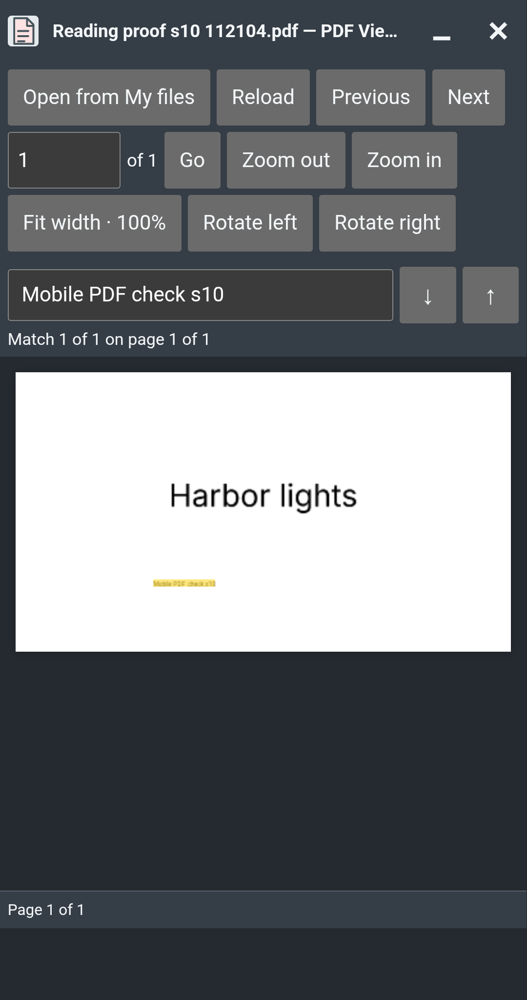

# PDF Viewer on the Galaxy S10+

Viewer `0c76681810b6` uses PDF Viewer source `67b8304` and the bundled PDF.js 4.10.38 worker. The [app README](../../README.md) documents the reading tools, file behavior, and build inputs.

1. In a signed-in session, select a PDF in **My files** and choose **Open With → PDF Viewer**. The test opened the one-page **Harbor lights** PDF exported from DeckCraft and edited in PdfCraft.
2. Tap **Zoom in** and verify the page gets wider. Tap **Fit width** to restore the original view.
3. In **Find text**, enter **Mobile PDF check s10**. Tap the down arrow and check the highlight and match count.

Chrome 158.0.8127.92 on the physical S10+ passed at 411 CSS pixels. Desktop Chromium repeated the same workflow at 820 and 1300 CSS pixels. The toolbar, match count, and page status text now have a measured 10.1:1 contrast against their dark background. The document retains its colors. The PDF's SHA-256 digest matched before and after reading in each session.

These checks cover opening a real document, zoom and fit, and searchable text. Multi-page navigation, rotation, password prompts, picker cancellation, and reload after an external file change are still outside the physical-device evidence.

On box-webhost, `sudo python3 -I -B /var/backups/webos-pdf-viewer-phone-contrast-0c76681810b6/deploy-viewer.py rollback` restores viewer `66dcd85df4ad`.

